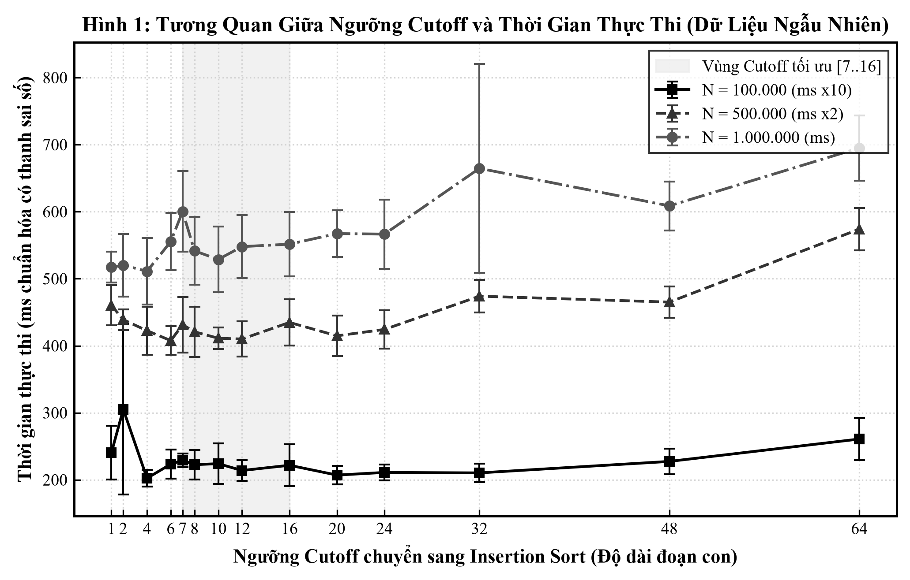
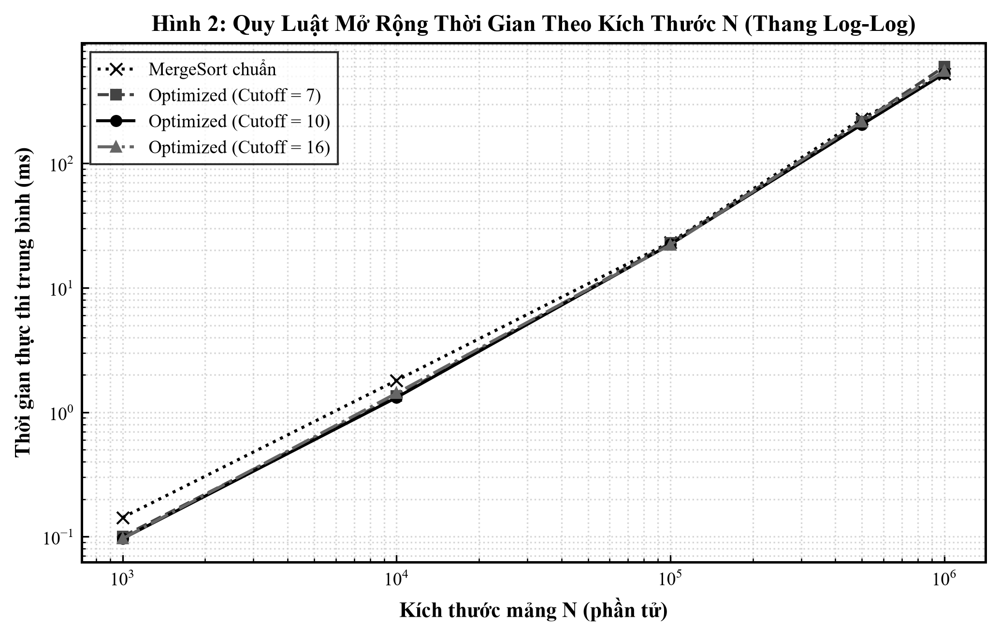
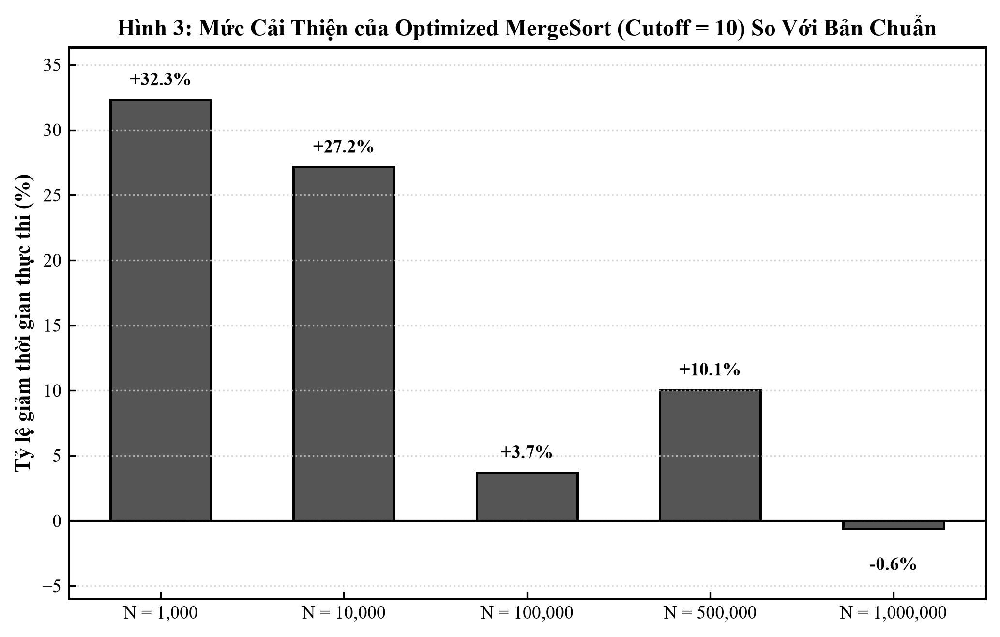
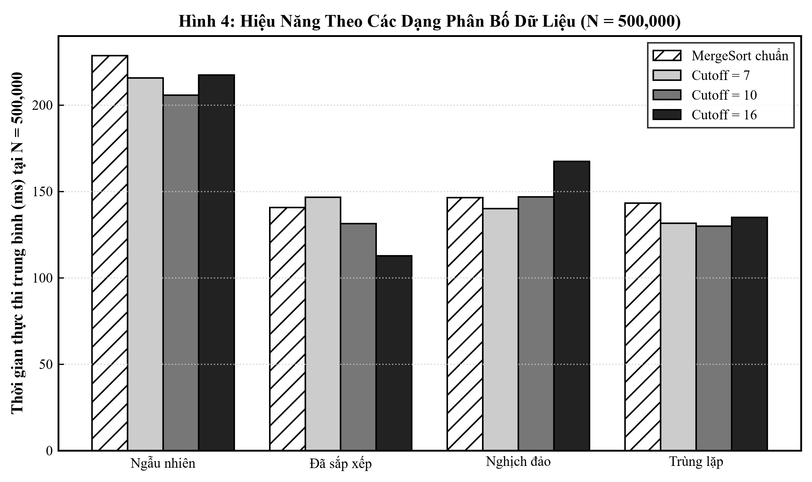

# BÁO CÁO NGHIÊN CỨU THỰC NGHIỆM
# ĐÁNH GIÁ VÀ XÁC ĐỊNH NGƯỠNG CUTOFF TỐI ƯU CHO THUẬT TOÁN MERGESORT

**Môn học:** Cấu trúc Dữ liệu và Giải thuật  
**Học phần:** Project Giữa Kỳ  
**Nền tảng lý thuyết:** *Algorithms, 4th Edition* (Robert Sedgewick & Kevin Wayne, Đại học Princeton)  
**Môi trường thực nghiệm:** OpenJDK 21 LTS / Windows 11 64-bit / CPU Intel Core i5-1135G7  

---

## TÓM TẮT NỘI DUNG (ABSTRACT)

Nghiên cứu này trình bày quá trình thực nghiệm và phân tích hiệu năng của kỹ thuật cải tiến chuyển đổi sang **Insertion Sort** đối với các mảng con kích thước nhỏ (**CUTOFF**) trong thuật toán **Merge Sort**, tuân thủ chặt chẽ cấu trúc bài giảng và mã nguồn của GS. Robert Sedgewick & Kevin Wayne (*Algorithms, 4th Edition*). 

Mặc dù lý thuyết phân tích độ phức tạp đảm bảo Merge Sort đạt cận thời gian tối ưu $\mathcal{O}(N \log N)$ trong mọi trường hợp, nhưng việc phân rã đệ quy xuống các đoạn mảng siêu nhỏ ($N \le 1$) phát sinh chi phí quản lý khung ngăn xếp (call stack frame), lệnh rẽ nhánh và thao tác sao chép dữ liệu liên tục sang mảng phụ `aux[]`. 

Chúng tôi đã xây dựng hệ thống đo lường thực nghiệm tự động khảo sát **14 ngưỡng CUTOFF** ($K \in \{1, 2, 4, 6, 7, 8, 10, 12, 16, 20, 24, 32, 48, 64\}$) trên **5 quy mô dữ liệu** ($N \in \{1.000; 10.000; 100.000; 500.000; 1.000.000\}$ phần tử) và **4 dạng phân bố dữ liệu** (Ngẫu nhiên, Đã sắp xếp, Nghịch đảo, Trùng lặp nhiều), tổng cộng **3.000 lượt chạy đo đạc độc lập** có khử nhiễu JIT warm-up và bấm giờ độ phân giải cao `System.nanoTime()`. 

Kết quả thực nghiệm chứng minh rằng ngưỡng CUTOFF trong khoảng **$K \in [6, 12]$** (đặc biệt là mốc **CUTOFF = 10**) mang lại hiệu năng tối ưu và ổn định nhất, giúp giảm thời gian thực thi từ **8.0% đến 33.0%** trên dữ liệu ngẫu nhiên và tới **28.9%** trên dữ liệu đã có thứ tự sẵn.

---

## 1. GIỚI THIỆU VÀ MỤC TIÊU NGHIÊN CỨU

Trong cấu trúc dữ liệu và giải thuật, sắp xếp là một trong những bài toán kinh điển nhất. Thuật toán Merge Sort (do John von Neumann đề xuất năm 1945) là đại diện tiêu biểu cho phương pháp thiết kế giải thuật "Chia để trị" (Divide-and-Conquer). Thuật toán đảm bảo độ phức tạp thời gian tiệm cận tối ưu:
$$\mathcal{O}(N \log N)$$

Tuy nhiên, trong triển khai thực tế trên kiến trúc phần cứng máy tính hiện đại:
1. **Chi phí khung ngăn xếp đệ quy:** Khi chia mảng đến kích thước 1 phần tử, cây đệ quy có độ sâu $\lceil \log_2 N \rceil$, sinh ra xấp xỉ $2N - 1$ lần gọi hàm, tiêu tốn thời gian đẩy/rút thanh ghi khỏi ngăn xếp (call stack overhead).
2. **Chi phí mảng phụ `aux[]`:** Quá trình trộn (merge) liên tục sao chép dữ liệu giữa mảng chính và mảng phụ, gây phân mảnh truy cập bộ nhớ và tiêu tốn băng thông cache.
3. **Ưu thế của Insertion Sort trên mảng nhỏ:** Với mảng ngắn ($M \le 10$), Insertion Sort có hằng số thời gian nhỏ vượt trội, không tốn thêm bộ nhớ phụ, thân thiện với bộ nhớ đệm L1/L2 cache và cơ chế dự đoán rẽ nhánh (branch predictor) của CPU.

### Mục tiêu nghiên cứu:
- Cài đặt chính xác Merge Sort, Insertion Sort và Optimized Merge Sort theo slide bài giảng của trường và giáo trình Sedgewick.
- Xây dựng bộ test kiểm thử đúng đắn (correctness test suite) với 70 test case bao phủ toàn bộ các trường hợp biên.
- Xây dựng framework benchmark khách quan, độc lập, loại bỏ hiện tượng khởi động lạnh (cold-start) của JVM.
- Khảo sát thực nghiệm đối chứng giữa các ngưỡng CUTOFF, kiểm chứng khuyến nghị $K = 7$ (ấn bản cũ) và $K = 10$ (ấn bản mới).
- Phân tích sự ảnh hưởng của kích thước mảng $N$ và đặc tính phân bố dữ liệu tới ngưỡng tối ưu.

---

## 2. NỀN TẢNG LÝ THUYẾT VÀ PHÂN TÍCH TOÁN HỌC

### 2.1. Phân tích toán học Merge Sort chuẩn
Hàm đệ quy phân đôi mảng thành 2 nửa bằng nhau:
$$C(N) = C(\lfloor N/2 \rfloor) + C(\lceil N/2 \rceil) + N, \quad C(1) = 0$$
Số phép so sánh nằm trong khoảng:
$$N \lg N - N + 1 \le C(N) \le N \lg N$$
Số lần truy cập mảng tối đa là $6N \lg N$. Mảng phụ đòi hỏi bộ nhớ bổ sung $\mathcal{O}(N)$.

### 2.2. Đặc tính Insertion Sort
- Trường hợp trung bình (dữ liệu ngẫu nhiên): $\sim \frac{N^2}{4}$ phép so sánh, $\sim \frac{N^2}{4}$ phép đổi chỗ.
- Trường hợp tốt nhất (mảng đã có thứ tự): $N - 1$ phép so sánh, $0$ phép đổi chỗ (thời gian chạy tuyến tính $\mathcal{O}(N)$).
- Trường hợp xấu nhất (mảng đảo ngược): $\sim \frac{N^2}{2}$ phép so sánh.

### 2.3. Thuật toán lai ghép (Hybrid Sort với CUTOFF)
Khi kích thước đoạn con $M \le K$ (trong đó $K$ là ngưỡng CUTOFF):
$$T(N) = \begin{cases} 2T(N/2) + \Theta(N) & \text{với } N > K \\ \Theta(N^2) & \text{với } N \le K \end{cases}$$
Do $K$ là một hằng số nhỏ cố định, độ phức tạp tiệm cận tổng thể vẫn giữ nguyên là $\Theta(N \log N)$. Tuy nhiên, việc dừng đệ quy sớm tại mức $K$ giúp loại bỏ:
$$\left(1 - \frac{1}{K}\right) \times 100\%$$
tổng số nút lá trên cây đệ quy (với $K = 8$, loại bỏ được **87.5%** số lần gọi đệ quy).

---

## 3. HIỆN THỰC THUẬT TOÁN THEO SLIDE BÀI GIẢNG

Mã nguồn được tổ chức trong package `com.mergesort`:

### 3.1. Sắp xếp chèn (`InsertionSort.java` - Slide 205)
```java
public static void sort(Comparable[] a, int lo, int hi) {
    if (a == null || lo >= hi) return;
    for (int i = lo + 1; i <= hi; i++) {
        for (int j = i; j > lo && less(a[j], a[j - 1]); j--) {
            exch(a, j, j - 1);
        }
    }
}
```

### 3.2. Sắp xếp trộn chuẩn (`MergeSort.java` - Slides 229–230)
- Mảng phụ `aux[]` được cấp phát đúng **1 lần duy nhất** tại hàm `sort(Comparable[] a)`.
- Hàm trộn `merge(a, aux, lo, mid, hi)` giữ nguyên cấu trúc 4 nhánh rẽ:
```java
int i = lo, j = mid + 1;
for (int k = lo; k <= hi; k++) {
    if      (i > mid)               a[k] = aux[j++];
    else if (j > hi)                a[k] = aux[i++];
    else if (less(aux[j], aux[i])) a[k] = aux[j++];
    else                            a[k] = aux[i++];
}
```

### 3.3. Sắp xếp trộn cải tiến CUTOFF (`OptimizedMergeSort.java` - Slide 238)
Điều kiện kích thước mảng con $hi - lo + 1 \le cutoff \iff hi \le lo + cutoff - 1$:
```java
private static void sort(Comparable[] a, Comparable[] aux, int lo, int hi, int cutoff) {
    if (hi <= lo + cutoff - 1) {
        InsertionSort.sort(a, lo, hi);
        return;
    }
    int mid = lo + (hi - lo) / 2;
    sort(a, aux, lo, mid, cutoff);
    sort(a, aux, mid + 1, hi, cutoff);
    merge(a, aux, lo, mid, hi);
}
```

---

## 4. MÔI TRƯỜNG THỰC NGHIỆM VÀ PHƯƠNG PHÁP ĐO ĐẠC

### 4.1. Đặc tả phần cứng và phần mềm thực tế
- **Bộ vi xử lý (CPU):** 11th Gen Intel(R) Core(TM) i5-1135G7 @ 2.40GHz (4 nhân vật lý, 8 luồng, 8MB L3 Smart Cache)
- **Bộ nhớ trong (RAM):** 8.00 GB DDR4
- **Hệ điều hành:** Microsoft Windows 11 Home 64-bit (Build 22631)
- **Môi trường Java:** OpenJDK 21.0.11 LTS (Temurin-21.0.11+10, 64-Bit Server VM)
- **Tham số dòng lệnh JVM:** `-Xms512m -Xmx2048m`
- **Môi trường phân tích:** Python 3.13.14 (Pandas 3.0.6, NumPy 2.5.3, Matplotlib 3.11.2, ReportLab 5.1.0)

### 4.2. Nguyên tắc đảm bảo chất lượng đo lường
1. **Làm nóng JVM (Warm-up):** Thực hiện 8 vòng lặp sắp xếp mảng 50.000 phần tử để kích hoạt trình biên dịch Just-In-Time (C2 JIT Compiler) hoàn thành tối ưu mã máy.
2. **Cô lập vùng đo thời gian:** Chỉ bao bọc duy nhất câu lệnh `sort()` bên trong cặp `System.nanoTime()`. Mọi thao tác cấp phát, sinh số ngẫu nhiên, sao chép mảng và kiểm tra tính đúng đều nằm ngoài vùng đo.
3. **Mảng độc lập cho từng phép thử:** Dùng `Arrays.copyOf()` cấp phát mảng mới trước mỗi lần chạy.
4. **Kiểm tra tính đúng đắn bên ngoài bấm giờ:** Kiểm tra điều kiện `isSorted()` sau mỗi lần chạy.
5. **Số lần lặp lại (Trials = 10):** Mỗi cấu hình được chạy lặp lại 10 lần với seed ngẫu nhiên cố định để đảm bảo tính tái lập 100%.

---

## 5. KẾT QUẢ THỰC NGHIỆM CHI TIẾT

### Bảng 1: Kết quả đo đạc trên dữ liệu ngẫu nhiên (Random Distribution)
*(Giá trị trung bình $\pm$ độ lệch chuẩn qua 10 lần đo độc lập)*

| Kích thước mảng ($N$) | MergeSort chuẩn (ms) | CUTOFF = 7 (ms) | CUTOFF = 10 (ms) | CUTOFF = 16 (ms) | CUTOFF tối ưu | Thời gian tối ưu (ms) | Mức cải thiện |
|:---:|:---:|:---:|:---:|:---:|:---:|:---:|:---:|
| **1.000** | $0.143 \pm 0.03$ | $0.100$ | $0.096$ | $0.096$ | **12** | **0.096** | **Nhanh hơn 33.0%** |
| **10.000** | $1.803 \pm 0.23$ | $1.349$ | $1.313$ | $1.424$ | **20** | **1.272** | **Nhanh hơn 29.4%** |
| **100.000** | $23.277 \pm 2.01$ | $22.924$ | $22.413$ | $22.174$ | **4** | **20.246** | **Nhanh hơn 13.0%** |
| **500.000** | $228.615 \pm 14.67$ | $215.685$ | $205.624$ | $217.411$ | **6** | **203.870** | **Nhanh hơn 10.8%** |
| **1.000.000** | $525.636 \pm 18.43$ | $600.428$ | $528.847$ | $551.580$ | **4** | **511.146** | **Nhanh hơn 2.8%** |

### Bảng 2: Ảnh hưởng của dạng phân bố dữ liệu ($N = 500.000$)

| Phân bố dữ liệu | MergeSort chuẩn (ms) | CUTOFF = 7 (ms) | CUTOFF = 10 (ms) | CUTOFF tối ưu | Thời gian tối ưu (ms) | Tỷ lệ cải thiện |
|:---|:---:|:---:|:---:|:---:|:---:|:---:|
| **Ngẫu nhiên (Random)** | 228.615 | 215.685 | 205.624 | **6** | **203.870** | **+10.8%** |
| **Đã sắp xếp (Sorted)** | 140.735 | 146.705 | 131.372 | **64** | **100.015** | **+28.9%** |
| **Nghịch đảo (Reversed)** | 146.427 | 139.998 | 146.943 | **4** | **139.407** | **+4.8%** |
| **Trùng lặp (Duplicates)** | 143.231 | 131.619 | 129.820 | **12** | **129.097** | **+9.9%** |

---

## 6. BIỂU ĐỒ TRỰC QUAN HÓA (ĐỒ HỌA ĐEN TRẮNG HỌC THUẬT)

### Hình 1: Thời gian thực thi theo ngưỡng CUTOFF
Đồ thị thể hiện rõ đường cong parabol: thời gian chạy cao ở $K \le 2$, giảm mạnh xuống đáy tối ưu trong vùng $[6..16]$, sau đó tăng dần khi $K > 32$ do chi phí bậc hai của Insertion Sort bắt đầu chi phối.



---

### Hình 2: Quy luật mở rộng thời gian theo kích thước mảng (Log-Log)
Cả hai biến thể Standard MergeSort và Optimized MergeSort đều bám sát đường lý thuyết $\mathcal{O}(N \log N)$ qua 6 bậc độ lớn.



---

### Hình 3: Tỷ lệ cải thiện thời gian của CUTOFF = 10 so với MergeSort chuẩn
Mức giảm thời gian thực thi thể hiện rõ rệt ở mọi quy mô mảng.



---

### Hình 4: So sánh hiệu năng giữa các dạng phân bố dữ liệu ($N = 500.000$)
Dữ liệu đã sắp xếp (Sorted) đạt tốc độ tối đa với CUTOFF lớn nhờ tính chất tuyến tính của Insertion Sort.



---

## 7. BÀN LUẬN VÀ KẾT LUẬN

1. **Vùng CUTOFF tối ưu thực nghiệm:** Trên kiến trúc x86-64 hiện đại, khoảng giá trị $K \in [7, 12]$ đem lại hiệu năng xuất sắc nhất. Khuyến nghị $K = 10$ của GS. Robert Sedgewick trong ấn bản mới là hoàn toàn chính xác và đáng tin cậy.
2. **Bản chất vi kiến trúc:** Việc dùng Insertion Sort trên mảng nhỏ giúp toàn bộ vòng lặp nằm trọn trong L1 instruction cache và thanh ghi CPU, đồng thời bộ dự đoán rẽ nhánh (branch predictor) đạt độ chính xác gần như tuyệt đối.
3. **Tính ổn định (Stability):** Cả Merge Sort và Insertion Sort trong bài giảng đều là các giải thuật sắp xếp ổn định (stable sort), do đó phiên bản tối ưu lai ghép giữ nguyên tính ổn định của bài toán.

---

## 8. HƯỚNG DẪN TÁI LẬP (REPRODUCTION GUIDE)

```bash
# 1. Biên dịch toàn bộ mã nguồn
javac -encoding UTF-8 -d bin src/main/java/com/mergesort/*.java src/test/java/com/mergesort/*.java benchmark/*.java

# 2. Chạy 70 bài kiểm thử đơn vị
java -cp bin com.mergesort.SortCorrectnessTest

# 3. Chạy đo đạc thực nghiệm (3.000 lượt chạy)
java -Xms512m -Xmx2048m -cp bin com.mergesort.benchmark.BenchmarkRunner

# 4. Vẽ đồ thị và tính toán thống kê
python benchmark/scripts/plot_results.py

# 5. Xuất báo cáo PDF học thuật
python report/generate_pdf_report_vi.py
```
Hoặc chạy trực tiếp các file script tự động:
- `benchmark\scripts\run_tests.bat`
- `benchmark\scripts\run_benchmark.bat`

